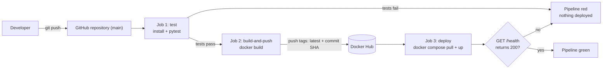
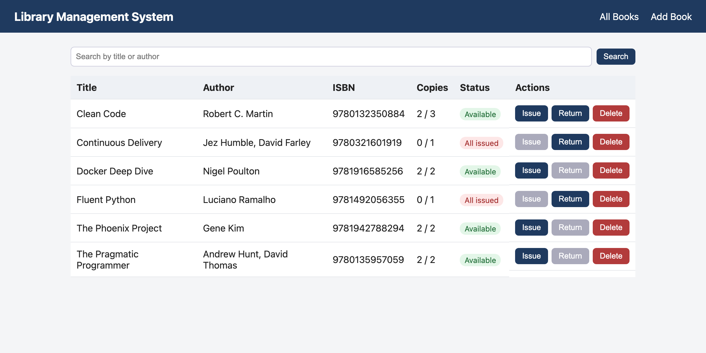
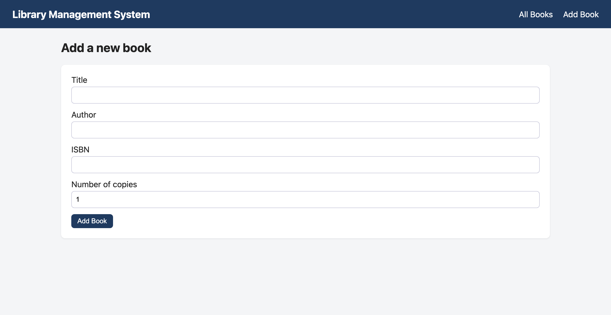
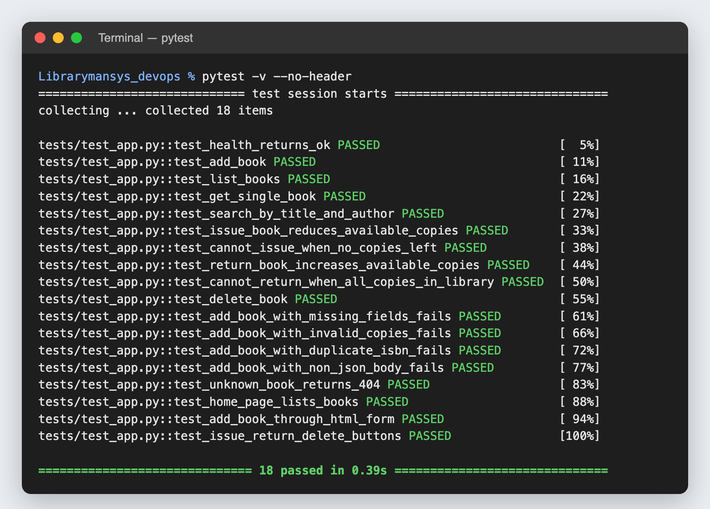
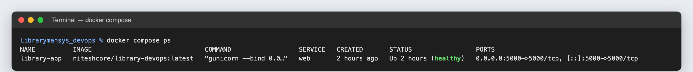
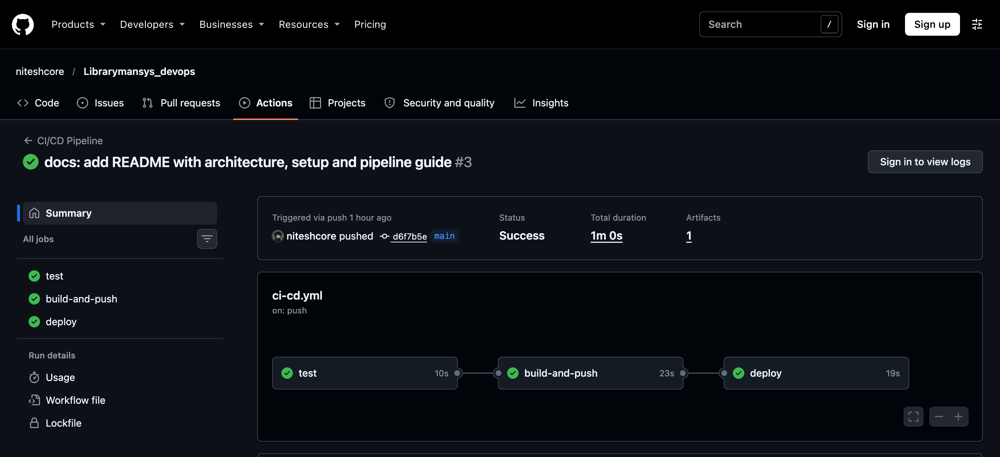
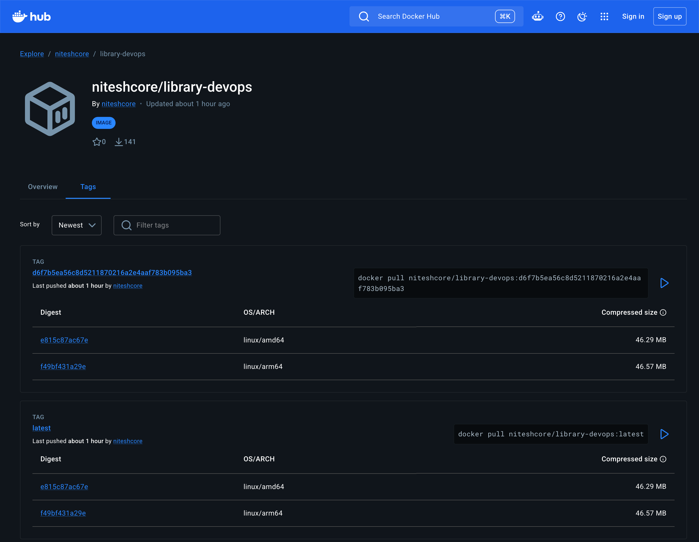

# Library Management System – DevOps Pipeline


A simple Flask web app for managing library books, with a fully automated DevOps pipeline: every push to `main` is tested, packaged as a Docker image, published to Docker Hub and deployed, without any manual step.

**Problem:** building, testing and deploying an application by hand is slow and error-prone, and nobody notices when something breaks.

**Solution:** GitHub Actions runs the tests on every push. If they pass, it builds a Docker image, pushes it to Docker Hub, deploys it with Docker Compose and checks that the app is healthy. If any step fails, the pipeline turns red and nothing broken is deployed.

---

## Features

- List all books with their availability status
- Add a book (title, author, ISBN, number of copies)
- Search books by title or author
- Issue a book (available copies go down) and return it (copies go up)
- Delete a book
- `/health` endpoint used by Docker and the pipeline
- JSON REST API under `/api/books`

## Tech stack

| Area | Tool |
|---|---|
| Language / framework | Python 3.11, Flask |
| Database | SQLite |
| Web server (production) | gunicorn |
| Testing | pytest (18 unit tests) |
| Containerization | Docker, Docker Compose |
| CI/CD | GitHub Actions |
| Image registry | Docker Hub (`niteshcore/library-devops`) |
| Version control | Git, GitHub |

---

## Architecture



**Flow:** Developer → Git push to GitHub → GitHub Actions (install, test) → Docker image build → Push to Docker Hub → Deploy with Docker Compose → Health check

---

## Project structure

```
Librarymansys_devops/
├── app/
│   ├── __init__.py          # App factory: settings, database, routes
│   ├── models.py            # All SQLite queries for the books table
│   ├── routes.py            # HTML pages, JSON API and /health
│   └── templates/           # base.html, index.html, add.html
├── tests/
│   └── test_app.py          # 18 pytest unit tests
├── .github/workflows/
│   └── ci-cd.yml            # GitHub Actions pipeline (test → build-and-push → deploy)
├── Dockerfile               # How the Docker image is built
├── docker-compose.yml       # How the container is run (port, volume, healthcheck)
├── .dockerignore            # Files kept out of the image
├── .gitignore               # Files kept out of Git
├── pytest.ini               # pytest settings
├── requirements.txt         # Python packages with fixed versions
├── run.py                   # Entry point
└── README.md
```

---

## Run it locally

**Prerequisites:** Git, Python 3.11+, Docker Desktop.

> **macOS note:** AirPlay Receiver uses port 5000. Turn it off in System Settings → General → AirDrop & Handoff, or the app cannot start on port 5000.

First get the code:

```bash
git clone https://github.com/niteshcore/Librarymansys_devops.git
cd Librarymansys_devops
```

### Option 1: Docker Compose (recommended)

```bash
docker compose up -d --build   # build the image and start the container
docker compose ps              # wait until the status shows "(healthy)"
```

Open http://localhost:5000. To use the image the pipeline published instead of building it yourself:

```bash
docker compose pull            # download niteshcore/library-devops:latest from Docker Hub
docker compose up -d
```

Stop it with `docker compose down`. Books are kept in the `library-data` volume, so they survive restarts. (`docker compose down -v` deletes the volume and all books.)

### Option 2: Python development server

```bash
python3 -m venv .venv
source .venv/bin/activate      # Windows: .venv\Scripts\activate
pip install -r requirements.txt
python run.py
```

Open http://localhost:5000. This copy stores its data in `data/library.db`, separate from the Docker volume.

---

## Run the tests

```bash
source .venv/bin/activate
pytest -v
```

Each test gets a fresh temporary database, so tests never touch real data. The 18 tests cover:

| Area | What is checked |
|---|---|
| Health | `/health` returns 200 and `{"status": "ok"}` |
| Add, list, get | Adding books, listing them, fetching one by id |
| Search | By title and by author, case-insensitive, no-match case |
| Issue / return | Copies go down and up; refused when none are left or all are in |
| Delete | Book is gone afterwards |
| Invalid input | Missing fields, invalid copies, duplicate ISBN, non-JSON body, unknown id (404) |
| HTML pages | Home page, add form, Issue / Return / Delete buttons |

---

## API reference

| Method | URL | Description | Success |
|---|---|---|---|
| GET | `/health` | Health check | 200 `{"status": "ok"}` |
| GET | `/api/books?q=<text>` | List all books, or search by title/author | 200 |
| GET | `/api/books/<id>` | Get one book | 200 / 404 |
| POST | `/api/books` | Add a book (JSON body) | 201 / 400 / 409 |
| POST | `/api/books/<id>/issue` | Issue one copy | 200 / 400 / 404 |
| POST | `/api/books/<id>/return` | Return one copy | 200 / 400 / 404 |
| DELETE | `/api/books/<id>` | Delete a book | 200 / 404 |

Example:

```bash
curl -X POST http://localhost:5000/api/books \
  -H "Content-Type: application/json" \
  -d '{"title": "Clean Code", "author": "Robert Martin", "isbn": "9780132350884", "copies": 2}'
```

---

## How the CI/CD pipeline works

The pipeline is defined in [`.github/workflows/ci-cd.yml`](.github/workflows/ci-cd.yml) and runs on every push and pull request to `main`.

| Job | Runs when | What it does |
|---|---|---|
| **1. test** (CI) | Every push and pull request | Checks out the code, sets up Python 3.11, installs dependencies, runs `pytest` |
| **2. build-and-push** (CD) | Push to `main`, only if `test` passed | Logs in to Docker Hub with secrets, builds the image for `amd64` and `arm64`, pushes tags `latest` and the commit SHA |
| **3. deploy** (CD) | Only if `build-and-push` passed | Pulls the new image, starts it with `docker compose up -d`, then a smoke test calls `/health` and fails the job unless it returns HTTP 200 |

Jobs are chained with `needs:`, so a failing test stops the pipeline before anything is built or deployed.

### Secrets

Credentials are never stored in the code. They are saved in GitHub under **Settings → Secrets and variables → Actions**:

| Secret | Value |
|---|---|
| `DOCKERHUB_USERNAME` | Docker Hub username |
| `DOCKERHUB_TOKEN` | Docker Hub access token with Read & Write access |

### Docker setup

- **Dockerfile:** `python:3.11-slim` base image; `requirements.txt` is copied and installed before the code so Docker can cache that layer; runs as a non-root user; starts gunicorn on port 5000.
- **docker-compose.yml:** one `web` service on port `5000:5000`, a named volume for the SQLite database, `restart: unless-stopped`, and a healthcheck that calls `/health` every 30 seconds.

---

## Screenshots

**Home page:** all books with their availability status and the Issue / Return / Delete buttons



**Add Book form**



**Unit tests:** all 18 pytest tests passing



**Docker:** the container is running and Docker reports it as healthy



**GitHub Actions:** test → build-and-push → deploy, all green



**Docker Hub:** the pipeline pushed the image with the `latest` and commit SHA tags, for both amd64 and arm64



---

## Team

| Member | Responsibility |
|---|---|
| Nitesh (Leader) | GitHub repository, planning, GitHub Actions CI/CD, Docker Hub, README, final demo |
| Mohit | Flask application and unit tests |
| Akash | Dockerfile, Docker Compose and screenshots |

DevOps Capstone Project, November 2026.
